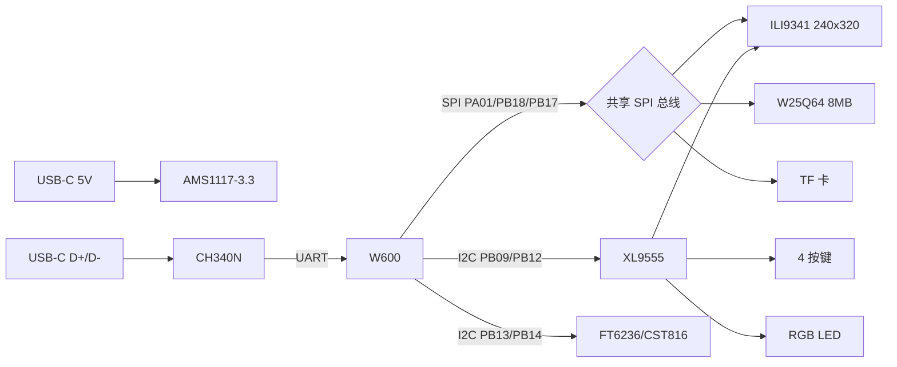

# W600 LCD DevBoard

**两块钱的 W600 模组 + ILI9341 240×320 屏，做成一块能点屏、能触摸、能读卡、能存图的完整开源板。**
硬件（KiCad / Gerber / BOM / 3D）、固件、构建脚本和实测记录都在这个仓库里。

<p align="center">
  
</p>

## 为什么做这块板

W600 是 WinnerMicro 2019 年的模组，逛某宝时两元一片，卖家说兼容 ESP8266。
买回来实测发现：模块自带的 AT 固件是裁剪版，没有 HTTP / MQTT 专用 AT、
没有 server 模式、没有 OTA，多轮 socket 开关后状态机还会残留（详见
[`docs/W600-AT-baseline.md`](docs/W600-AT-baseline.md)）。

既然 AT 不够用，就基于 W600 SDK 自己写固件。于是有了这块板：把点屏需要的
FPC、触摸、外部 Flash、TF 卡、按键、RGB 灯和 USB-C 串口一次性做齐，
顺手把 LCD / Flash / SD 三设备共享 SPI 的坑也踩完了。

## 特性

- **显示**：ILI9341 240×320 SPI，20 MHz 主机 SPI，硬件刷屏 + 1bpp 快速展开
- **触摸**：FT6236 / CST816 自动探测，I2C 轮询，支持画板演示
- **存储**：板载 W25Q64（8 MB）+ TF 卡，FAT16/32 文件流
- **开机 logo**：TF 卡 `/logo.bin` 同步到 Flash，之后从 Flash 流式刷屏
- **Bad Apple**：TF 卡实时播放 1bpp 视频，RLE 压缩，240×180 实测 18 fps
- **交互**：4 个用户按键 + 共阳 RGB 灯，全部挂在 XL9555 上
- **自检**：LCD / Flash / TF / Wi-Fi 整板自检固件，失败项有串口定位日志
- **共享总线**：LCD / Flash / SD 共用 SPI，单总线任务 + CS 互锁，不会互相踩
- **全开源**：原理图、PCB、Gerber、BOM、LCSC 库、3D 模型、固件源码齐全

## 硬件

| 项目 | 规格 |
| --- | --- |
| MCU | WinnerMicro W600（TW-03），Cortex-M3 @ 80 MHz |
| 存储 | 1 MB Flash / 288 KB SRAM，2.4 GHz 802.11 b/g/n |
| 模组封装 | ESP-12F 兼容，可直接替换同封装模块 |
| 屏幕 | ILI9341 240×320，16Pin 0.5 mm FPC，SPI，无 MISO |
| 触摸 | FT6236 / CST816，I2C，TP_INT 可选 |
| 外部 Flash | W25Q64，8 MB，SPI NOR |
| 存储卡 | TF 卡槽，SPI 模式，FAT16/32 |
| IO 扩展 | XL9555，16 位 I2C GPIO，地址 `0x24` |
| USB | USB-C 供电 + CH340N USB-UART |
| 电源 | AMS1117-3.3，USB-C 5 V 输入 |
| 按键 | 4 个用户键（KEY0–KEY3）+ 1 个复位键 |
| 指示灯 | XL-1615RGBC-RF 共阳 RGB，低有效 |
| PCB | 2 层，1.6 mm，约 45.8 × 34.6 mm |



### 引脚分配

| 信号 | W600 / 扩展 | 说明 |
| --- | --- | --- |
| SPI_CLK | PA01 | LCD / Flash / SD 共用，AF option 3 |
| SPI_MOSI | PB18 | 共用，AF option 3 |
| SPI_MISO | PB17 | Flash / SD 共用；LCD 不接 MISO |
| LCD_CS | PB11 | GPIO 片选，低有效 |
| LCD_DC | XL9555 P0_3 | 命令/数据 |
| LCD_RST | XL9555 P0_0 | 低有效 |
| LCD_PWR | XL9555 P0_2 | 高有效（面板使能/背光电源） |
| FLASH_CS | PB15 | W25Q64 片选，低有效 |
| SD_CS | PB16 | TF 卡片选，低有效 |
| XL9555_SCL | PB09 | 软件 I2C（该脚无硬件 I2C 复用） |
| XL9555_SDA | PB12 | 软件 I2C，4.7 kΩ 上拉 |
| XL9555_INT | PB08 | 本仓库未使用 |
| TOUCH_SCL | PB13 | 触摸 I2C，4.7 kΩ 上拉 |
| TOUCH_SDA | PB14 | 触摸 I2C，4.7 kΩ 上拉 |
| TP_RST | XL9555 P0_1 | 触摸复位，低有效 |
| TP_INT | PB10 | 触摸中断，本例程轮询 |
| KEY0–KEY3 | XL9555 P0_4–P0_7 | 10 kΩ 上拉，按下为低 |
| LED_R/G/B | XL9555 P1_0–P1_2 | 共阳 +3.3 V，低有效 |

注意：`PB11/PB12` 被 LCD_CS 和 XL9555 占用，SDK 默认 UART1 不能同时使用。

### 关键器件

| 器件 | 型号 | 封装 / LCSC |
| --- | --- | --- |
| 主控模组 | W600 / TW-03 | ESP-12F 兼容，LCSC `C19949064` 封装 |
| USB-UART | CH340N | SOP-8，`C2977777` |
| 3.3 V LDO | AMS1117-3.3 | SOT-223，`C6186` |
| SPI NOR | W25Q64（8 MB） | SOP-8，`C2985658` |
| IO 扩展 | XL9555 | TSSOP-24，`C609791` |
| LCD 座 | 16P 0.5 mm FPC | `C2856801` |
| TF 卡座 | push-push | `C393941` |
| RGB 灯 | XL-1615RGBC-RF | `C965840` |
| 按键 | SMD tact | `C720477` |

> BOM 里 U1 标的是 `W25Q64JWSSIQ`（1.8 V 型号），但板上 VCC/WP/HOLD 都接
> `+3.3 V`。实装请以丝印为准；若用 3.3 V 型号（`W25Q64JV/FV`）可直接忽略
> 这条 BOM 记录。

原理图、PCB、Gerber、交互式 BOM 和 3D 模型都在
`hardware/W600模组开发板/`，用 KiCad 打开 `W600模组开发板.kicad_pro`。

## 快速开始

### 1. 烧录固件

不编译也能先跑：`software/prebuilt/` 下有三个已验证镜像。

| 镜像 | MD5 | 用途 |
| --- | --- | --- |
| `software/prebuilt/normal/lcd.fls` | `1791c60b82ef57f549977b33b2b58be5` | 点屏 + Flash logo + 触摸演示 |
| `software/prebuilt/board/lcd.fls` | `40599329128e30d0ccb35f0766beda27` | 整板自检；会擦除 W25Q64 最后一个 4 KB 扇区 |
| `software/prebuilt/badapple/lcd.fls` | `37d9c99c9a29b558624ee2ace29a5a39` | 播放 TF 卡 `/BADAPPLE.BIN` |

W600 进 secboot 需要在上电/复位时拉低 boot 脚，串口出现 `CCC...` 后才能写。
板上 CH340N 没有 DTR/RTS，**不能自动复位进下载模式**，需要手动操作；
烧录前先关掉串口助手，避免 COM 口被独占。

```bash
# 在 W600 SDK 的 example 目录，产物为 bin/lcd/lcd.fls
make -f Makefile.mk APP_BIN_NAME=lcd TARGET=lcd COMPILE=gcc FLASH_SIZE=1M \
     DL_PORT=COM10 DL_BAUD=921600 flash
```

也可以直接用 `w600tool` 写 `lcd.fls`。镜像 MD5 会随编译时间变化
（`__DATE__` / `__TIME__`），以构建脚本输出为准。

### 2. 编译

依赖 W600 SDK 3.4.0、`arm-none-eabi-gcc` 7-2017q4 和 GNU make。

```powershell
# 普通点屏 / Flash logo / 触摸
pwsh -File software/build-lcd.ps1 -Variant normal

# 整板自检
pwsh -File software/build-lcd.ps1 -Variant board

# 只探测外部 Flash
pwsh -File software/build-lcd.ps1 -Variant flashonly

# TF 卡 Bad Apple 播放
pwsh -File software/build-lcd.ps1 -Variant badapple
```

脚本默认找 `F:/projects/w600-sdk`，也可以设 `W600_SDK` 环境变量或传
`-SdkRoot`；工具链默认从 Arduino15 路径查找，可用 `-Toolchain` 覆盖。
流程是：复制 `software/lcd` 到 `$SdkRoot/example/lcd` → 调 SDK 的
`example/Makefile.mk` → 生成 `bin/lcd/lcd.fls` → 复制到
`software/prebuilt/<variant>/`。

### 3. 准备 TF 卡

FAT32、MBR 分区，文件名用 8.3 格式：

```text
/logo.bin       开机图片（可选）
/BADAPPLE.BIN   Bad Apple 帧流（badapple 变体）
```

`/logo.bin` 是 20 字节头 + RGB565 大端像素：

```text
"LOGO" | u16 w | u16 h | u16 fmt=1 | u16 reserved | u32 data_size | u32 reserved
```

有卡时固件会比较 TF 与 Flash 内容，不同才擦写，避免反复磨损；没有卡或
没有文件就直接用 Flash 里已有的 logo。

### 4. 首次上电

1. 插好 16Pin FPC，USB-C 供电，串口 **115200 8N1** 打开
2. 启动日志会打印 XL9555 探测、Flash JEDEC ID、SD 初始化和 logo 同步结果
3. 屏幕先显示 logo 3 秒，然后进入彩条 + 触摸画板演示
4. `badapple` 变体在 logo 后循环播放，按任意用户键停止并进入触摸演示

## 固件变体

| 变体 | 编译开关 | 行为 |
| --- | --- | --- |
| `normal` | — | 点屏、Flash logo、触摸画板 |
| `board` | `-DBOARD_CHECK -DSD_DIAG` | LCD / Flash / TF / Wi-Fi 自检，结果上屏 + 串口日志 |
| `flashonly` | `-DFLASH_ONLY` | 只探测并打印 W25Q64 ID |
| `badapple` | `-DBAD_APPLE` | 播放 TF 卡 `/BADAPPLE.BIN` |
| `overclock` | `-DOC_TEST` | 80/40/80/160 MHz 负载对比，160 MHz 会挂死 |

`overclock` 镜像不预置，需要本地构建。实测 40 MHz 耗时约为 80 MHz 的
2.0 倍，80 MHz 重跑误差 <0.3%；160 MHz 切换后串口无输出、板子挂死，
按复位键并重刷 `normal` 即可恢复。W600 标称 80 MHz，没有可用的中间档位。

## 功能与实测

### 点屏与触摸

`lcd.c` 负责 ILI9341 初始化、填充、画线/矩形、8×16 字体和 1bpp 图像流；
`lcd_demo.c` 复刻 STM32 参考工程的彩条、灰阶和触摸画板。触摸初始化会把
`TP_RST` 拉低 10 ms、释放 120 ms，再探测 `0x38`（FT6236）或 `0x15`
（CST816）。

### Flash logo

`w25qxx.c` 管理 W25Q64：ID 和短命令走 GPIO bit-bang，长块读写优先
20 MHz 主机 SPI DMA，失败自动回退。logo 固定放在 `0x700000`，占 256 KB；
`0x7FF000` 留给板级自检擦写，不会碰固件区。

这块板的 W600 主机 SPI 读 Flash 在所有 mode 下都返回 `FF`，所以 ID 和
状态寄存器必须走 bit-bang；LCD 仍然用主机 SPI。两者切换由
`lcd_spi_resume()` 恢复 Mode 0。

### Bad Apple

`tools/bad_apple.py` 用 ffmpeg 解码，按硬阈值或 Bayer 抖动压成 1bpp，
默认输出 RLE 帧流。推荐先按下面三档生成（BIN 体积大，不随仓库提交）：

| 文件 | 分辨率 | fps | 格式 | 大小 |
| --- | --- | --- | --- | --- |
| `BADAPPLE.BIN` | 240×180 | 18 | RLE | 2.33 MB |
| `BADAPPLE_FAST.BIN` | 192×144 | 24 | RLE | 2.34 MB |
| `BADAPPLE_TINY.BIN` | 160×120 | 24 | RLE | 1.82 MB |
| `BADAPPLE_RAW_240X180_12FPS.BIN` | 240×180 | 12 | raw | 14 MB |

复制要播的文件到 TF 卡并改名 `BADAPPLE.BIN`。RLE 把 240×180 的 SD 流量
从 5400 B/帧压到约 620 B/帧；LCD 数据固定 86.4 KB，20 MHz 下约 35 ms，
所以 18 fps 的瓶颈在 LCD，不在卡。完整帧格式和刷屏路径见
[`software/lcd/README.md`](software/lcd/README.md)。

### 整板自检

`board` 变体依次验证 LCD、W25Q64、TF 卡和 Wi-Fi 扫描，屏幕显示三行
PASS/FAIL，串口打印细节。失败项会给出具体阶段，例如
`LCD init failed`、`FLASH: 0x9F BB ...`、`SD: CMD0 try ...`。

## 软件结构

```text
software/lcd/user/
  main.c          启动流程和任务入口
  lcd.c            ILI9341 驱动
  lcd_demo.c       彩条 / 画板演示
  touch.c          FT6236 / CST816
  xl9555.c         LCD 电源/复位/DC/按键/RGB
  spi_bus.c        LCD / Flash / SD 共享总线，队列 + CS 互锁
  w25qxx.c         W25Q64 驱动
  sd_fs.c          SD 卡 bit-bang + FAT16/32
  logo.c           TF → Flash logo 同步与显示
  badapple.c       TF 流式播放
  ba_rle.c         LEB128 RLE 解码（纯 C，可主机测试）
  board_check.c    整板自检
  drivers_test.c   按键 / RGB 自测
  oc_test.c        超频对比
```

三个 SPI 设备共用 `PA01/PB18/PB17`，`spi_bus.c` 用一个总线任务串行化
事务：调用者投递后阻塞，只有总线任务能改 CS 和时序；`g_cs_low_dev`
保证同一时刻最多一个片选为低，事务结束强制恢复主机 SPI 复用，
避免 SD/Flash bit-bang 之后 LCD 花屏。

## 目录

```text
hardware/                 KiCad 工程、Gerber、iBOM、LCSC/3D 模型
software/lcd/             W600 SDK 应用源码
software/build-lcd.ps1    复制源码进 SDK 并编译
software/prebuilt/        已验证的预编译镜像
scripts/                  W600 AT 模块的串口 / 性能 / 长跑脚本
tools/                    Bad Apple 转换、ESP-AT 下载脚本
partitions/               ESP32-C3 2MB AT 分区表
docs/W600-AT-baseline.md  W600 AT 固件实测、速率与稳定性记录
docs/images/board.jpg     实物图
```

`firmware/`、`build/`、`results/`、`.tmp/` 和 `logo.bin` 是本地素材/输出，
不进入仓库。

## W600 AT 模块实测

`docs/W600-AT-baseline.md` 记录了同一批 TW-03 的完整基线，结论先放这里：

| 能力 | 结果 |
| --- | --- |
| TCP client / UDP / DNS / PING | ✅ |
| TLS | ✅ 模块内完成 |
| TCP server / 多路 socket | ❌ |
| HTTP / MQTT 专用 AT | ⚠️ 没有，需 TCP/SSL 手写 |
| 921600 UART 下 TCP↓ | 83.9 KB/s（0.67 Mbps，93% UART） |
| UDP↑ | 32 KB/s（单次 ≤2048 B） |
| 10 小时长跑 | 3621 轮，MQTT 回环 99.97%，HTTP 120/120 |

**瓶颈是 921600 UART，不是 Wi-Fi。** 要更高吞吐只能用 W600 SDK 自己写
TCP/UDP，或者换 ESP32。AT 固件没有源码、没有 secboot 通道，socket
状态机残留只能靠主机侧重连规避。

## 常见问题

**屏全黑，但串口有初始化日志？**
先量 FPC 11 脚 `LCD_PWR` 是否为高；若面板使能低有效，把
`xl9555_init()` 里的 `XL9555_P0_LCD_PWR` 取反。再确认 XL9555 地址
`0x24` 和 PB09/PB12 上拉。

**花屏 / 闪烁？**
把 `LCD_SPI_HZ` 从 20 MHz 降到 10 MHz。

**红蓝反了 / 方向不对？**
红蓝反改 ILI9341 `0x36` 参数（`0x08` → `0x00`）；方向不对按参考工程
改 `0xC8/0x78/0xA8` 并同步交换宽高。

**触摸没反应？**
确认 `TP_RST` 已释放、I2C 上拉正常，并看启动日志探测到 `0x38` 还是
`0x15`；两种芯片坐标寄存器相同。

**Flash ID 读到 `FF FF FF`？**
核对 U1 丝印和供电（BOM 的 1.8 V 型号 vs 板上 3.3 V）、PB15 片选、
PB17 MISO。固件探测前会先发 `0xFF/0xAB/0x66+0x99` 退出 QPI、释放
掉电和软复位。

**TF 卡不识别 / 掉帧？**
用 FAT32 + MBR，文件名 8.3；看启动日志的 `SD: data clock ...`。
固件会从 8 MHz 逐档降到 400 kHz，卡慢时会自动降档。

**烧录进不去 secboot？**
先关串口助手；手动拉低 boot 脚再复位/上电，看到 `CCC...` 再写。
CH340N 没有 DTR/RTS，不能靠工具自动复位。

**为什么 Flash/SD 用 GPIO bit-bang，不用硬件 SPI？**
这块板的 W600 主机 SPI 读 Flash 和 SD 的 R1 都会错位（CMD0 返回
`0xC0`），硬件 mode 0/3 都不行；同一张卡 bit-bang 正常。主机 SPI 留给
LCD，Flash/SD 的 bit-bang 时序由 `spi_bus` 统一调度。

## 验证状态

| 项目 | 状态 |
| --- | --- |
| LCD 初始化 / 刷屏 / 文字 / 图形 | ✅ 板上验证 |
| 触摸 FT6236 / CST816 | ✅ 板上验证 |
| W25Q64 ID / 读 / 写 / 擦除 | ✅ 板上验证 |
| TF 卡 FAT16/32 + logo 同步 | ✅ 板上验证 |
| Bad Apple RLE 播放 | ✅ 240×180 @ 18 fps |
| 4 按键 + RGB | ✅ 驱动自测 |
| 整板自检 | ✅ |
| Wi-Fi 应用 | ⚠️ 未集成到本仓库固件，AT 实测见 docs |
| 160 MHz 超频 | ❌ 挂死，无可用档位 |

## 资料与交流

- W600 SDK 3.4.0（官方）+ `arm-none-eabi-gcc` 7-2017q4
- 器件数据手册随 LCSC 库放在 `hardware/.../easyeda_convertlib.datasheet/`
- W600 的公开资料比较零散，仓库里能公开的部分已经整理进 `docs/`；
  其余 SDK、AT 固件和手册在交流群文件里
- 有问题欢迎开 Issue，带上串口日志和板上丝印/版本

## 说明

- W600 是清库存模组，**没有长期供货和固件维护承诺**，量产前先确认 BOM
  和 secboot 烧录工装（boot 脚必须能拉低）。
- 本仓库的 AT 实测只针对手上这批 TW-03，不同批次/固件的命令集可能不同。
- 硬件按 3.3 V 设计；换 1.8 V Flash 型号时必须同时改供电，不能只改 BOM。
