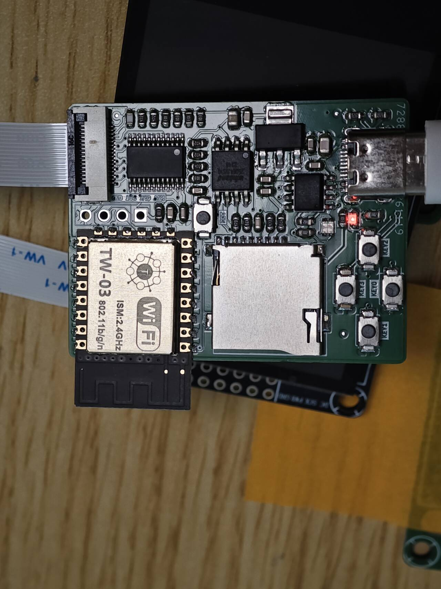

# W600 LCD DevBoard

W600（WinnerMicro）模组开发板 + ILI9341 240x320 SPI 屏的点屏、触摸和 Flash logo
工程。仓库同时保留这块板子的 KiCad 原理图、PCB、Gerber、BOM 和 3D 模型。

<p align="center">
  
</p>

## 目录

```text
hardware/                 KiCad 工程、Gerber、BOM、LCSC/3D 模型、数据手册
software/lcd/             W600 SDK 应用源码（LCD / XL9555 / Flash / SD / 触摸）
software/build-lcd.ps1    把源码复制进 W600 SDK 并编译
software/prebuilt/        当前源码的预编译镜像
scripts/                  W600 AT 模块的串口/性能/长跑脚本
tools/                    ESP-AT 下载辅助脚本
docs/W600-AT-baseline.md  早期 W600 AT 模块实测与基线记录
logo.bin                  开机图片（也可放 TF 卡 /logo.bin）
```

`firmware/`（ESP32-C3 AT 原始固件包）、`build/`、`results/` 和 `.tmp/` 是本地
素材/输出，不进入仓库。

## 硬件

- W600 模组，Cortex-M3，1 MB Flash / 288 KB SRAM
- ILI9341 240x320 SPI 屏：SCLK PA1、MOSI PB18、CS PB11、DC/PWR/RST 走 XL9555
- XL9555 I2C 扩展：PB9/PB12，地址 0x24
- W25Q64/W25Q128 外部 Flash：PB15 CS、PB17 MISO，和 LCD 共用 SPI
- TF 卡：SPI，PB16 CS
- 触摸：FT6236 / CST816，I2C PB13/PB14，TP_RST 走 XL9555

原理图和 PCB 在 `hardware/W600模组开发板/`，可直接用 KiCad 打开
`W600模组开发板.kicad_pro`。KiCad 的 `hardware/.../.history/` 是本地版本
历史，保留在磁盘上但不进入仓库。

## 固件

源码在 `software/lcd/user/`：

- `lcd.c` / `lcd_demo.c`：ILI9341 初始化、文字、图形、触摸画板
- `spi_bus.c`：LCD / Flash / SD 共享 SPI 总线和 CS 互锁
- `w25qxx.c`：W25Q64/W25Q128 驱动；ID 走 GPIO bit-bang，长块读写优先
  20 MHz 主机 SPI DMA，失败自动回退
- `logo.c`：从 TF 卡同步 `/logo.bin` 到 Flash `0x700000`，开机从 Flash 流式刷图
- `xl9555.c`：LCD 电源、复位、DC、背光和按键扩展
- `board_check.c` / `sd_diag.c`：板级和 SD 诊断固件

## 构建

依赖：

- W600 SDK 3.4.0，默认路径 `F:/projects/w600-sdk`，也可用 `W600_SDK` 环境变量
- `arm-none-eabi-gcc` 7-2017q4（默认从 Arduino15 路径查找）
- GNU make

```powershell
# 普通点屏 / Flash logo
pwsh -File software/build-lcd.ps1 -Variant normal

# 板级自检 + SD 诊断
pwsh -File software/build-lcd.ps1 -Variant board

# 只探测 Flash
pwsh -File software/build-lcd.ps1 -Variant flashonly
```

脚本会先把 `software/lcd` 复制到 `$SdkRoot/example/lcd`，再调用 SDK 的
`example/Makefile.mk`，生成 `bin/lcd/lcd.fls` 并复制到
`software/prebuilt/<variant>/lcd.fls`。

## 预编译镜像

| 镜像 | MD5 | 用途 |
| --- | --- | --- |
| `software/prebuilt/normal/lcd.fls` | `3cd0961b7398362a823e4fab066ce6fe` | 点屏 + Flash logo + 触摸演示 |
| `software/prebuilt/board/lcd.fls` | `ba2b38e90f3bf648b971a1ce5956beb2` | 板级自检；会擦除 W25Q64 最后一个 4 KB 扇区 |

## 开机流程

1. `lcd_init()` 初始化 XL9555、SPI 和 ILI9341，并填黑屏
2. `w25qxx_init()` 探测外部 Flash
3. 若 TF 卡有 `/logo.bin`，与 Flash 内容比较；不同则擦写并回读校验
4. 从 Flash `0x700000` 流式读取 logo 并送屏，不需要整幅图进 RAM
5. 进入触摸画板演示

## 说明

- 早期 W600 AT 模块的实测、AT 命令、ESP32-C3 烧录工具记录见
  `docs/W600-AT-baseline.md`。
- 预编译镜像的 MD5 会随编译时间变化（`__DATE__` / `__TIME__`），以脚本输出为准。
